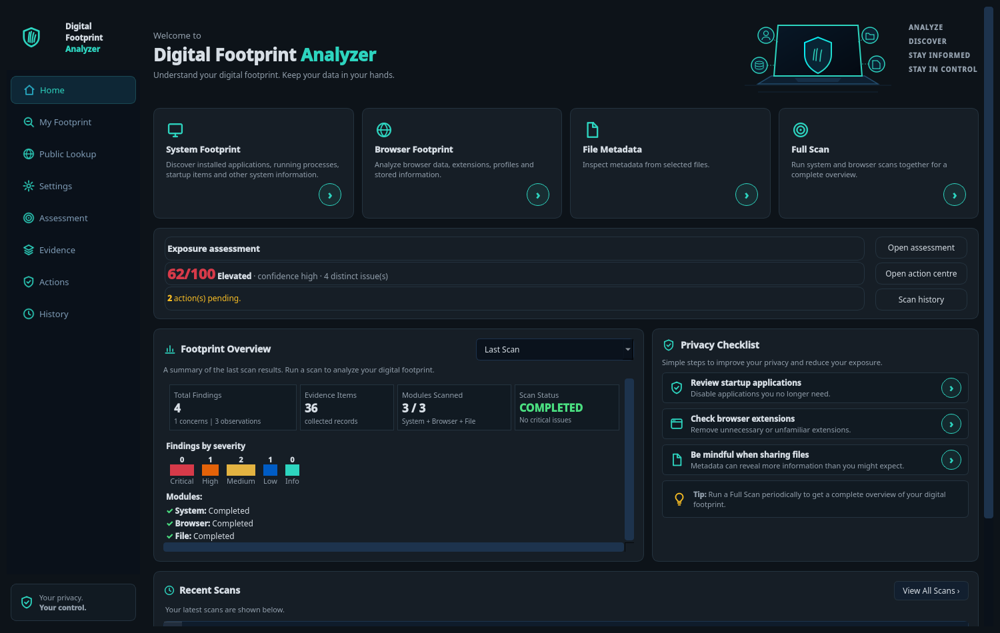
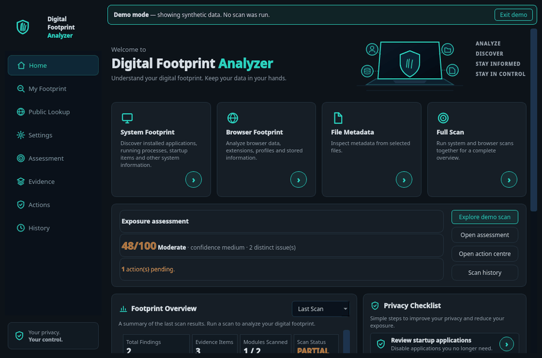
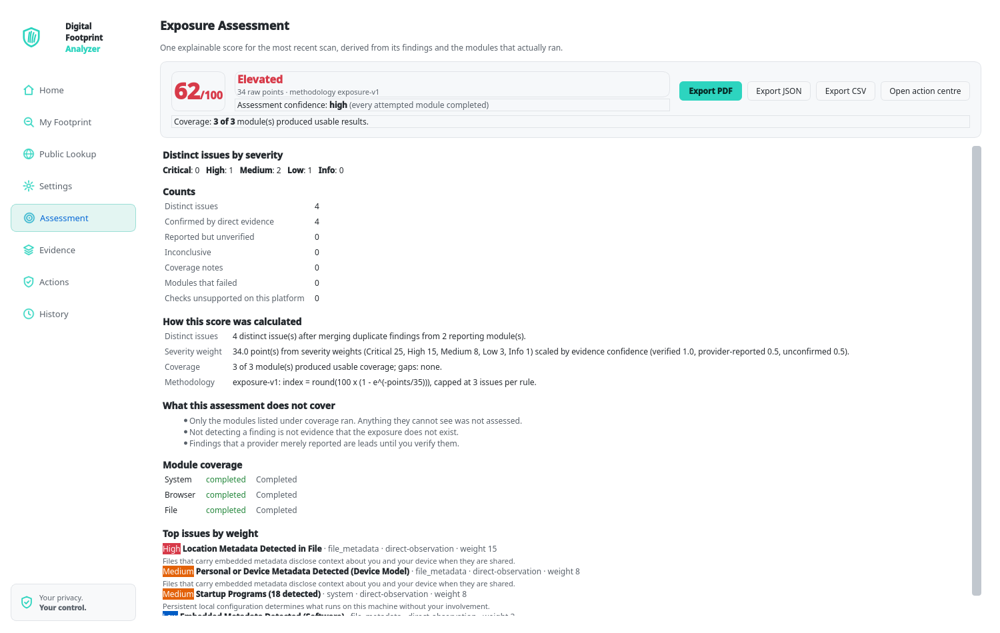
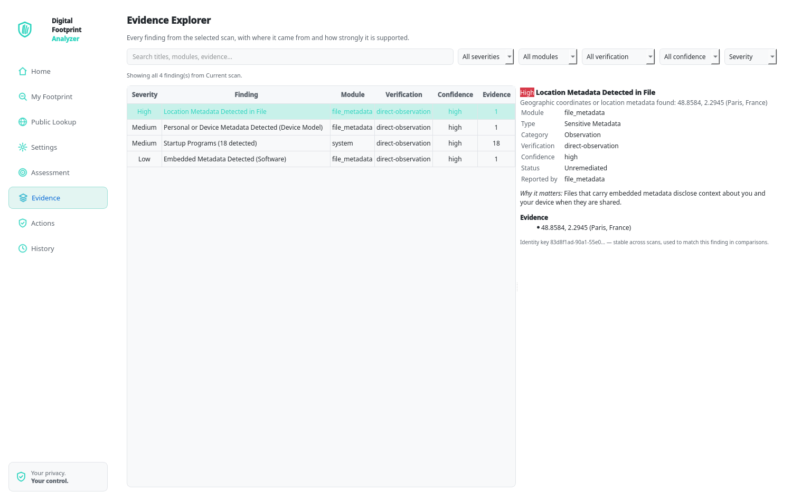
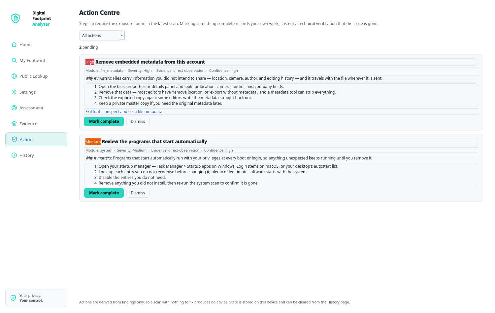

# Digital Footprint Analyzer

[](https://github.com/Athuljose77/digital-footprint-analyzer/actions/workflows/tests.yml)
[](LICENSE)
[](https://www.python.org/)

A local-first desktop application for understanding the digital footprint left
on your own computer and on public platforms—without uploading the evidence
anywhere.

The app audits system details, browser profiles and extensions, and metadata
from one explicitly selected file. It separates **findings** from **collected
evidence**, reports coverage gaps honestly, and turns the result into a short,
prioritised action list. Email and username lookups are the only features that
use the network, and only when you explicitly start them.

<p align="center">
  
</p>

> Screenshots use synthetic demonstration data. They do not show a real
> person's hostname, paths, accounts, or scan history.

## Why this project exists

Most footprint-checking tools ask you to hand over the evidence first. This
project takes the opposite approach:

- **Local by default.** System, browser, and file scans run on the machine and
  never upload what they collect.
- **Evidence is not a verdict.** An installed app or browser profile is not
  labelled malicious. Findings explain what was observed and what it may mean.
- **Coverage is part of the result.** If a module could not run, the app says so
  and withholds certainty instead of pretending the machine is clean.
- **Actions, not automatic changes.** The app recommends remediation steps; it
  does not delete files or change system settings for you.
- **No telemetry.** There is no analytics, account, cloud sync, or update check.

## Features

| Module | What it collects |
|---|---|
| **System Footprint** | OS details, installed applications, running processes, startup items |
| **Browser Footprint** | Detected browsers, profiles, extension metadata, scan-coverage notes |
| **File Metadata** | Metadata from one explicitly selected file (never scanned recursively) |
| **Full Scan** | System + Browser together, with File Metadata only when a file is selected |
| **Public Lookup** | Email breach and username presence checks—the only features that use the network |

Want to see the result format before scanning your own machine? Click
**Explore demo scan** on Home to load a synthetic Full Scan into the real
assessment, evidence, action, and export views. Demo data is clearly labeled
and never writes to the persisted scan-history or action-state databases.

<p align="center">
  
</p>

| Page | What it adds |
|---|---|
| **Assessment** | One explainable exposure score (`exposure-v1`): severity breakdown, confidence, verification status, coverage gaps, and methodology limits. Export the same bundle as PDF, JSON, or CSV. |
| **Evidence** | Search and filter every collected record by severity, module, verification, and confidence; inspect provenance and identity. |
| **Actions** | A prioritised remediation centre with explanations, concrete steps, and links to official documentation. Completed, pending, and dismissed states are stored locally. |
| **History** | Persistent local SQLite history with comparison between scans: new, unchanged, modified, resolved, and not-rechecked issues. Delete individual scans or clear everything. |

## Supported platforms

| Platform | Status |
|---|---|
| Windows 10/11 | Supported |
| Linux | Supported |
| macOS | Not currently supported |

The System and Browser collectors have separate Windows and Linux implementations.
Unsupported platforms are reported as unavailable rather than silently producing
empty results.

## Quick start

Requirements: Python 3.12+ and Git. Run all commands from the project root.

### Linux

```bash
python3 -m venv .venv
.venv/bin/pip install --upgrade pip
.venv/bin/pip install -r requirements.txt
.venv/bin/python app/main.py
```

Optional editable install with a command entry point:

```bash
.venv/bin/pip install -e .
.venv/bin/dfa
```

### Windows

```bat
python -m venv .venv
.venv\Scripts\pip install --upgrade pip
.venv\Scripts\pip install -r requirements.txt
run_app.bat
```

Optional editable install with a command entry point:

```bat
.venv\Scripts\pip install -e .
.venv\Scripts\dfa
```

`run_app.bat` uses `.venv\Scripts\pythonw.exe`. The virtual environment is
ignored by Git and is not part of the repository.

## Tests

The test suite is offline-safe: public-lookup fetchers are injected, Qt runs in
offscreen mode, and preferences and databases are redirected to temporary
directories.

```bash
QT_QPA_PLATFORM=offscreen .venv/bin/python -m pytest app/tests/ -q -p no:cacheprovider
```

Current local result: **618 passed, 113 subtests passed** in about 4 minutes.

The GitHub Actions workflow runs the same suite on Linux and Windows for pushes
to `main` and pull requests. It also installs the package and launches the
`dfa` entry point in a short startup smoke test. See
[CONTRIBUTING.md](CONTRIBUTING.md) for the development workflow.

## Screenshots

| Assessment | Evidence |
|---|---|
|  |  |

| Actions | Home |
|---|---|
|  |  |

A synthetic example of the exported report is available in
[docs/sample-report](docs/sample-report/README.md).

## Architecture

```text
app/main.py                     entrypoint; applies the saved theme before the first window
app/ui/theme.py                 colour tokens, application chrome, theme switching
app/ui/icons.py                 inline SVG line icons
app/ui/main_window.py           dashboard, footprint views, report HTML, settings
app/ui/pages/                   Assessment, Evidence, Actions, and History pages
app/ui/workers.py               QThread scan worker
app/core/scan_controller.py     scan orchestration, including run_full_scan
app/core/demo.py                synthetic Full Scan used by demo mode and samples
app/core/findings_processor.py  canonical findings aggregation
app/core/findings/              modular rule processor
app/core/risk/                  exposure-v1 score and explanations
app/core/history/               local SQLite history, comparison, sanitization
app/core/remediation/           action catalogue, engine, persisted action state
app/core/reporting/             one report bundle rendered to PDF / JSON / CSV
app/services/                   system, browser, file-metadata, email, and username services
pyproject.toml                  package metadata and dfa command entry points
scripts/generate_sample_report.py  regenerates the synthetic sample report
scripts/generate_demo_gif.py    regenerates the demo walkthrough GIF
```

Every scan produces the shared data models in `app/models/common.py`. PDF,
JSON, and CSV exports all render from one `ReportBundle`, so the number in a
report cannot disagree with the number on screen.

More detail: [Architecture](docs/ARCHITECTURE.md) ·
[Risk methodology](docs/RISK_METHODOLOGY.md) ·
[Report schema](docs/REPORT_SCHEMA.md) ·
[Privacy](docs/PRIVACY.md).

## Privacy

Nothing leaves the machine unless you start an email or username lookup on
**Public Lookup**. Full Scan is local-only and never includes those lookups.
Scan history and action state live in two SQLite files under your platform data
directory and can be deleted from the UI at any time.

See [docs/PRIVACY.md](docs/PRIVACY.md) for the exact boundaries and limitations.

## What this project is not

- Not an antivirus or a replacement for a professional security audit.
- Not a complete inventory of every file, browser, or account.
- Not a tool that automatically deletes files or changes system settings.
- Not a service that uploads scan evidence for analysis.
- Not a source of a "safe" or "unsafe" verdict about a person or device.

## Contributing

Contributions are welcome. Start with [CONTRIBUTING.md](CONTRIBUTING.md) for
setup, test, and review expectations. Look for issues labeled
[`good first issue`](https://github.com/Athuljose77/digital-footprint-analyzer/labels/good%20first%20issue)
or [`help wanted`](https://github.com/Athuljose77/digital-footprint-analyzer/labels/help%20wanted)
if you want a scoped place to start. For security issues, follow
[SECURITY.md](SECURITY.md) instead of opening a public issue.

See [ROADMAP.md](ROADMAP.md) for planned work and [CHANGELOG.md](CHANGELOG.md)
for notable changes.

## License

Released under the [MIT License](LICENSE).
