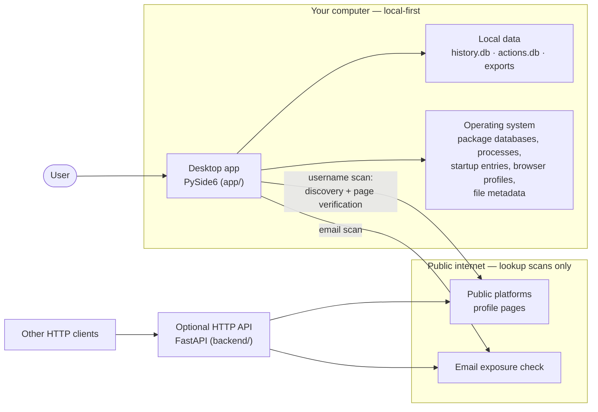
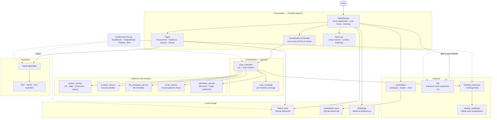
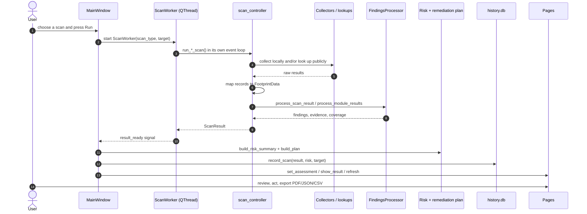
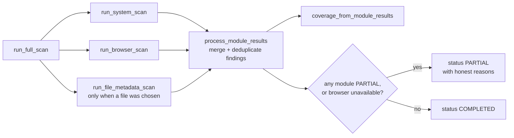
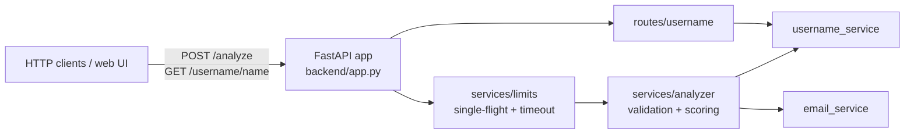

# Architecture

How the Digital Footprint Analyzer is put together: what runs where, how a
scan travels from collectors to findings, scoring, storage, and exports, and
which parts are allowed to touch the network.

The guiding constraint is **local-first**: scans run on your machine, results
are stored on your machine, and the only outbound requests are the public
lookup modules (username and email), which ask public sources about a handle
or address you typed in. See [PRIVACY.md](PRIVACY.md) for the exact
promises; this document shows how the code keeps them.

## System context

The FastAPI backend is a thin HTTP wrapper around the *same* service modules
the desktop app uses in-process (`backend/services/`). The desktop app never
needs the API running; it imports those services directly.

## Components

Every layer exchanges the plain data models in `app/models/common.py`
(`ScanResult`, `FootprintData`, `Finding`, `Risk`, `Recommendation`), so the
UI, scoring, storage, and exporters all read the same objects.

## Scan lifecycle

`MainWindow._record_scan_assessment` is the single place a finished scan
becomes an assessment: the score, the remediation plan, and the stored
history all come from there, so the dashboard, pages, exports, and history
can never disagree about the same scan.

### Full Scan aggregation

A module that reports `PARTIAL` or `UNAVAILABLE` is surfaced as a limitation
rather than silently dropped; coverage findings keep the gap visible in
scoring and reports.

## Local storage

| Location | Contents |
|---|---|
| `$XDG_DATA_HOME/DigitalFootprintAnalyzer/history.db` | Scan history and comparison state (SQLite). Overrides: `DFA_DATA_DIR`, `DFA_HISTORY_DB`. |
| `$XDG_DATA_HOME/DigitalFootprintAnalyzer/actions.db` | Remediation marks: done / pending / dismissed (SQLite). |
| `QSettings("DigitalFootprintAnalyzer", "Preferences")` | Theme mode, high-contrast selection, font scale, scan preferences. |
| User-chosen path | Exported reports (PDF / JSON / CSV), built from the same `ScanResult`, `RiskSummary`, and remediation plan the UI shows. |

## Network surface

| Module | What leaves the machine | Guards |
|---|---|---|
| Username | The handle, plus profile-page requests: discovery runs a bundled Sherlock-style subprocess, then verification fetches public pages with `httpx`. | Public-address check and host/URL block reasons (SSRF), response size caps, timeouts, and candidates can never be counted as confirmed by mistake. |
| Email | The address, to a breach/exposure check service. | Input validation, timeout; failures are reported as errors, never as results. |
| System · Browser · File & Metadata | Nothing. All collection is local. | — |

## Backend API (optional)

Requests are validated before anything runs (the API starts subprocesses and
makes outbound requests, so an unvalidated field would be a denial-of-service
surface). Busy and timeout conditions return honest `429` / `504` JSON, and
errors are never dressed up as results.

## Design rules the code keeps

- **Local-first by default.** Only Username and Email scans consult the
  public internet, and the app says so where it matters.
- **One source of truth for the score.** `app/core/risk` produces the single
  `RiskSummary` used by the dashboard, Assessment page, reports, and history.
- **One wording source per finding.** Startup findings share one title and
  description template; entry notes come from the offline
  `app/core/startup_catalogue.py`, and unrecognised entries are reported as
  unrecognised instead of guessed at.
- **Limitations are first-class.** Partial modules, unavailable collectors,
  methodology limits, and coverage gaps are shown, not hidden.
- **One theme system.** All colours flow through `app/ui/theme.py`; pages
  re-render HTML and re-apply templates on a runtime theme switch.

## Related documents

- [RISK_METHODOLOGY.md](RISK_METHODOLOGY.md) — how the exposure score is built.
- [PRIVACY.md](PRIVACY.md) — exactly what is stored and what is sent.
- [REPORT_SCHEMA.md](REPORT_SCHEMA.md) — the exported JSON/CSV/PDF contract.
